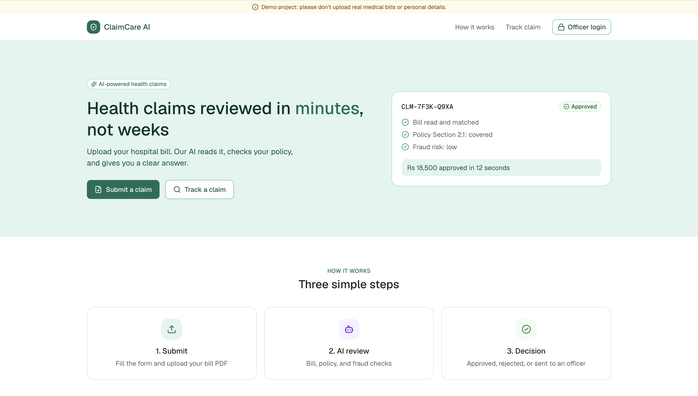
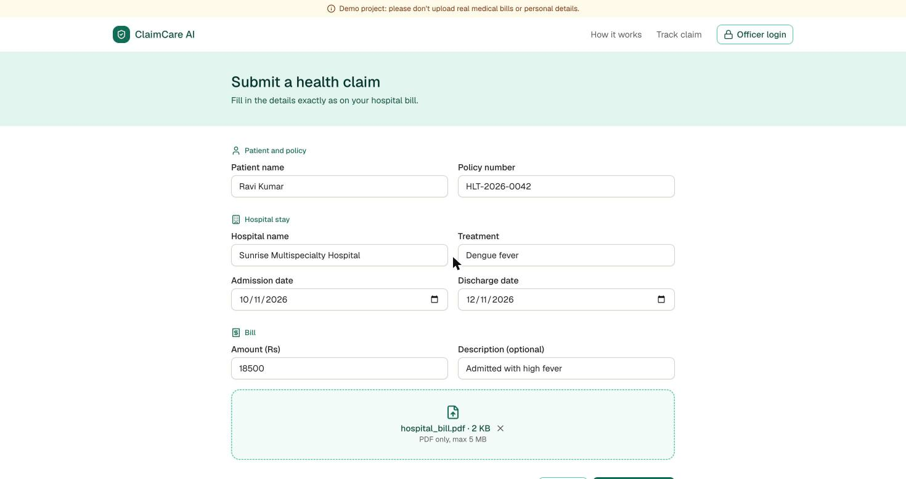
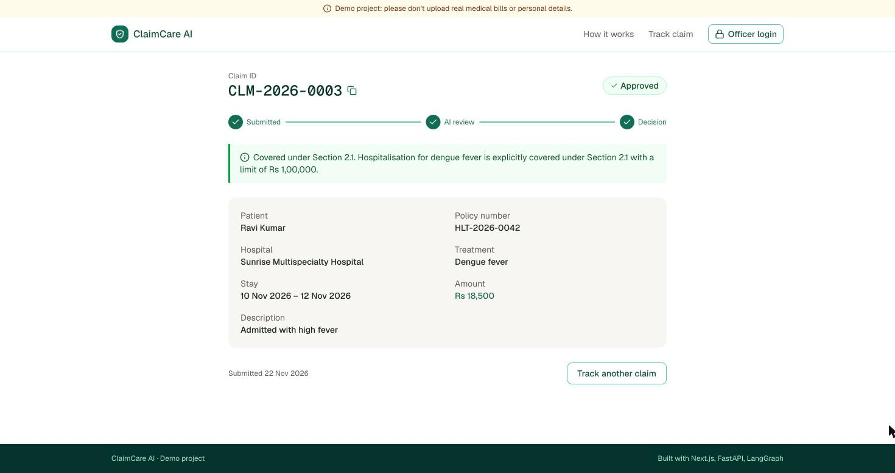
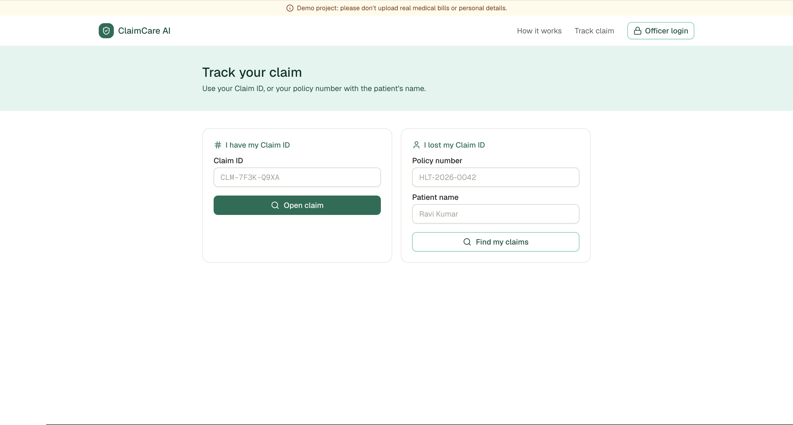
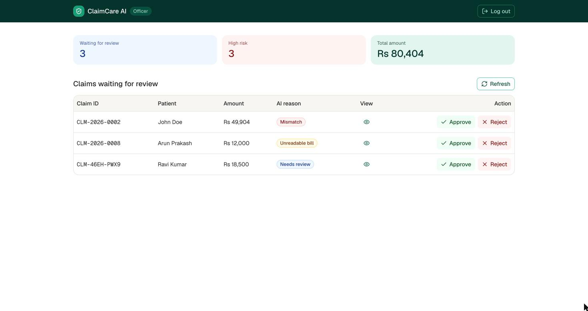
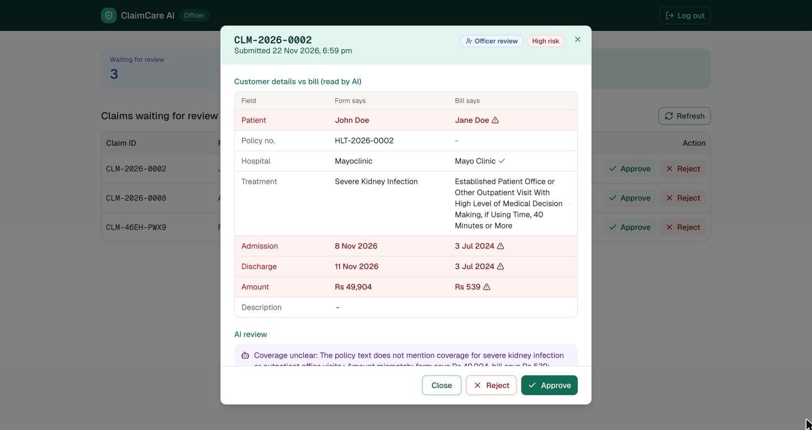
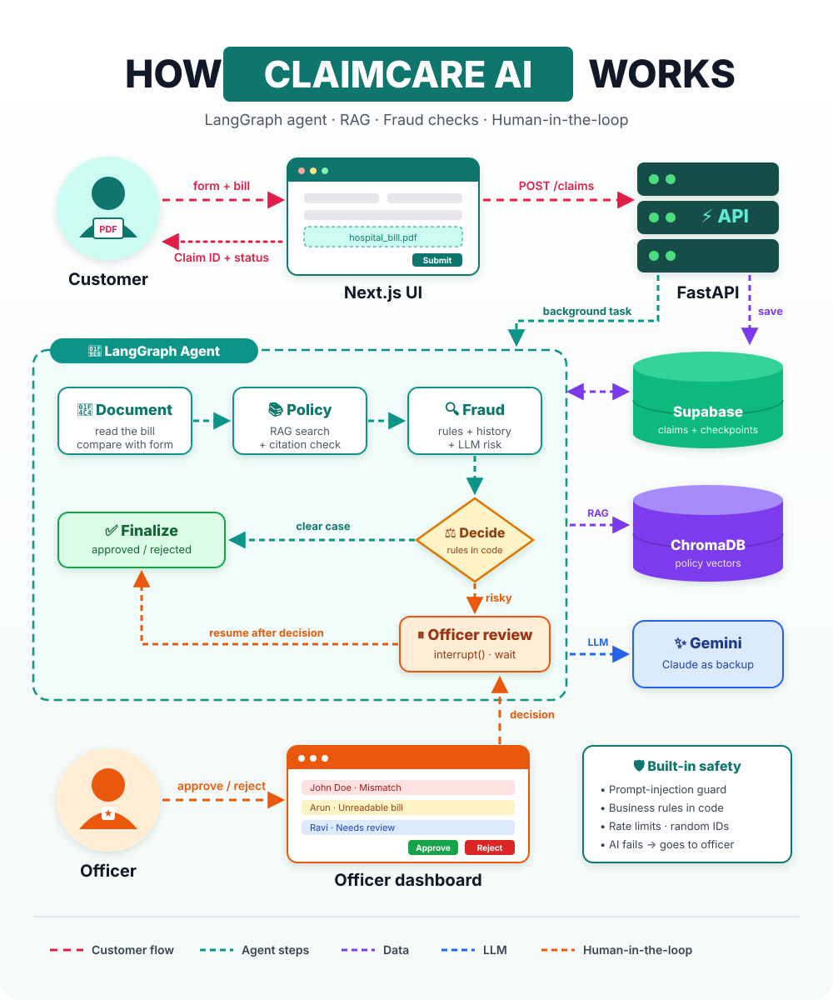

<div align="center">

# 🛡️ ClaimCare AI

### AI agent that reviews health insurance claims in minutes, not weeks

[](https://github.com/manisrivi/ai-insurance-claim-agent/actions/workflows/ci.yml)


</div>

---

## 📌 Overview

Health insurance claims are slow because a person has to read every hospital bill, check it against the policy, and look for fraud.

**ClaimCare AI** automates that review with a **LangGraph multi-step agent**:

1. A customer submits a claim form with the **hospital bill PDF**.
2. The agent **reads the bill**, **checks the policy with RAG** (with an exact section citation), and **checks for fraud**.
3. Simple claims are **approved or rejected automatically**. Risky claims **pause** and wait for a **human officer** (human-in-the-loop).

> **Portfolio project.** The insurance policy and the sample bills in `backend/data/` are fictional.

---

## ✨ Features

| For | Feature |
|---|---|
| 👤 Customer | Submit a claim with a bill PDF and get a random Claim ID (`CLM-7F3K-Q9XA`) |
| 👤 Customer | Track a claim live by Claim ID, or by policy number + patient name |
| 👤 Customer | Clear decision with the policy section that was used (e.g. *"Covered under Section 2.1"*) |
| 🤖 AI agent | Extracts bill details with structured output and compares them with the form |
| 🤖 AI agent | Finds the right policy sections with RAG (ChromaDB) and verifies the citation |
| 🤖 AI agent | Fraud check: field mismatches, claim history, and an LLM risk opinion |
| 🧑‍💼 Officer | Review queue with summary cards, a side-by-side *form vs bill* view, and approve/reject with a note |
| 🧑‍💼 Officer | The paused agent resumes from where it stopped after the officer decides |

---

## 📸 Screenshots

| Landing page | Submit a claim |
|---|---|
|  |  |
| **AI decision with policy citation** | **Track a claim** |
|  |  |
| **Officer review queue** | **Fraud check: form vs bill** |
|  |  |

---

## 🏗️ Architecture

<p align="center">
  
</p>

### Agent nodes

| Node | Job |
|---|---|
| `document` | The LLM extracts the bill fields (structured output). Code compares them with the form: name, hospital, dates, amount (1% tolerance). |
| `policy` | ChromaDB finds the top policy sections. The LLM decides *covered / not covered / unclear*. Code checks that the cited section really exists in the retrieved text. |
| `fraud` | Always checks the claim history. The LLM gives a risk opinion, and hard rules in code (mismatch, too many claims) force high risk. |
| `decide` | Pure code: not covered → rejected; unclear, high risk, or above ₹50,000 → officer review; otherwise approved. |
| `officer` | Human-in-the-loop with `interrupt()`. State is saved in Postgres (`PostgresSaver`, `thread_id = claim_id`). |
| `finalize` | Writes the final status and notes to Supabase. |

---

## 🧠 Design decisions

| Decision | Why |
|---|---|
| **LangGraph** instead of a single LLM call | Each step is a clear node that can be tested on its own. Conditional edges route claims, and `interrupt()` gives a real pause/resume for the human officer. |
| **Business rules in code, not in the prompt** | Money decisions must be predictable. The LLM gives opinions; code makes the final call, so a clever bill text can't change the rules. |
| **RAG with a citation check** | The policy is too long for every prompt. RAG sends only the relevant sections, and the citation check stops the LLM from inventing a section number. |
| **Human-in-the-loop for risky claims** | High-value or suspicious claims need a person. The agent pauses, saves its state, and resumes after the decision, so no work is lost. |
| **Postgres checkpointer** | Agent state survives server restarts. Claims stuck in processing are recovered on startup. |
| **Background processing** | The customer gets a Claim ID instantly and is not blocked while the AI works. |
| **Safe fallback** | If the AI fails or times out, the claim goes to an officer instead of being lost or wrongly approved. |
| **Gemini with a Claude backup** | Retries and a backup provider keep the agent working when one API is down or rate-limited. |
| **ChromaDB local / cloud switch** | A local folder in development, Chroma Cloud in production (`CHROMA_MODE`). Similarity is computed in code, so both modes score the same. |

---

## 🧰 Tech stack

| Layer | Tools |
|---|---|
| Frontend | Next.js (App Router), TypeScript, shadcn/ui, Tailwind CSS |
| Backend | Python, FastAPI, Pydantic, psycopg 3 |
| AI | LangGraph, LangChain, Gemini (`gemini-3.5-flash-lite`), Claude (backup) |
| RAG | ChromaDB, `gemini-embedding-001`, pypdf, RecursiveCharacterTextSplitter |
| Database | Supabase (PostgreSQL): claims + agent checkpoints |
| Observability | LangSmith tracing |
| Quality | pytest (fake LLM, no real DB needed), ESLint |
| DevOps | Docker, Docker Compose, GitHub Actions CI |

---

## 📁 Project structure

```
ai-insurance-claim-agent/
├── backend/
│   ├── app/
│   │   ├── main.py          # FastAPI app, routes, rate limits
│   │   ├── config.py        # settings from .env
│   │   ├── db.py            # Supabase / Postgres queries
│   │   ├── llm.py           # Gemini + Claude with fallback
│   │   ├── schemas.py       # Pydantic models
│   │   ├── agent/           # LangGraph: state, nodes, graph, runner
│   │   └── rag/             # ingest, store, retriever (ChromaDB)
│   ├── data/                # fictional policy.pdf + sample bills
│   ├── sql/schema.sql       # database tables
│   └── tests/               # pytest suite
├── frontend/
│   └── src/app/             # landing, submit, track, status, officer pages
├── docker-compose.yml
└── .github/workflows/ci.yml
```

---

## 🚀 Getting started

### Option 1: Docker (easiest)

Needs Docker Desktop.

```bash
cp backend/.env.example backend/.env   # then fill in your values
docker compose up --build              # first time
docker compose up                      # next times
docker compose down                    # stop
```

Open **http://localhost:3000** (API docs: http://localhost:8000/docs).

### Option 2: Run locally

**Backend**
```bash
cd backend
python3 -m venv venv && source venv/bin/activate
pip install -r requirements.txt
cp .env.example .env              # fill in your values
# Run sql/schema.sql once in the Supabase SQL editor
python -m app.rag.ingest          # load the policy into ChromaDB
uvicorn app.main:app --reload     # http://127.0.0.1:8000/docs
```

**Frontend** (second terminal)
```bash
cd frontend
npm install
cp .env.example .env.local
npm run dev                       # http://localhost:3000
```

### Environment variables

| Variable | Purpose |
|---|---|
| `GOOGLE_API_KEY` | Gemini (LLM + embeddings) |
| `ANTHROPIC_API_KEY` | Claude backup (optional) |
| `DATABASE_URL` | Supabase Postgres connection string |
| `OFFICER_API_KEY` | Officer access key (24+ random characters in production) |
| `ENVIRONMENT` | `development` or `production` |
| `CORS_ORIGINS` | Allowed frontend URLs |
| `TRUSTED_PROXY_HOPS` | Proxies in front of the API (0 locally, 1 on Render) |
| `MAX_CLAIMS_PER_DAY` | Site-wide daily cap on new claims |
| `CHROMA_MODE` | `local` or `cloud` (+ `CHROMA_API_KEY`, `CHROMA_TENANT`, `CHROMA_DATABASE`) |
| `LANGSMITH_*` | Tracing (optional) |

See `backend/.env.example` for the full list. Never commit `.env`.

---

## 🧪 Testing

```bash
cd backend
pip install -r requirements-dev.txt
pytest -q
```

The tests use a **fake LLM** and need **no real database or API keys**. They cover the PDF reader, business rules, the agent graph, RAG, the API, and security checks.
**GitHub Actions** runs the backend tests and the frontend lint + build on every push.

---

## 🔌 API

| Method | Path | Who | Purpose |
|---|---|---|---|
| `GET` | `/health` | anyone | Server check |
| `POST` | `/claims` | customer | Submit the form + bill PDF → returns the Claim ID |
| `GET` | `/claims/{claim_id}` | customer | Status of one claim |
| `GET` | `/claims?policy_number=&patient_name=` | customer | Claims for a policy + patient (both must match) |
| `GET` | `/officer/claims` | officer (`X-Officer-Key`) | Claims waiting for review |
| `POST` | `/officer/claims/{claim_id}/decision` | officer (`X-Officer-Key`) | `{"decision": "approved" \| "rejected", "note": "..."}` |

---

## 🔒 Security

- **Unguessable Claim IDs** (`CLM-7F3K-Q9XA`), so nobody can browse other people's claims
- **Policy search needs both** the policy number and the patient name
- **Rate limits per IP** for submits, reads and officer requests (HTTP 429). The real IP is read safely behind a proxy (`TRUSTED_PROXY_HOPS`), so a faked `X-Forwarded-For` cannot bypass them
- **Daily safety cap** on new claims for the whole site (`MAX_CLAIMS_PER_DAY`), so the LLM bill stays under control
- **Row Level Security** on every table, so Supabase's public REST API cannot read claims
- **PDF validation** (type, size, pages, encryption). PDFs are never stored, only their text
- **Prompt-injection guard**: bill text is treated as data, and business rules live in code
- **Parameterized SQL** everywhere
- **Officer key** checked with a constant-time compare; weak keys are refused in production
- **One decision per claim**: a database lock stops two officers deciding the same claim at once
- **Bill text, risk level and AI notes are never returned to customers**: they get a safe status message; only officers see the fraud details
- API docs are hidden in production

---

## 📄 Sample bills

Ready-made test bills in `backend/data/sample_bills/`:

| Bill | Form amount | Expected result |
|---|---|---|
| 1. Dengue, ₹18,500 | 18500 | ✅ Approved (Section 2.1) |
| 2. Cosmetic rhinoplasty, ₹45,000 | 45000 | ❌ Rejected (Section 3.1) |
| 3. Angioplasty, ₹75,000 | 75000 | 🧑‍💼 Officer review (above ₹50,000) |
| 4. Viral fever, bill ₹6,500 | 80000 | 🧑‍💼 Officer review (amount mismatch) |

---

## ☁️ Deployment checklist

- [ ] `ENVIRONMENT=production` (hides API docs, refuses weak officer keys)
- [ ] `OFFICER_API_KEY`: 24+ random characters
- [ ] `CORS_ORIGINS`: the live frontend URL
- [ ] `TRUSTED_PROXY_HOPS=1` when the API runs behind Render / Railway / Nginx
- [ ] Frontend built with `NEXT_PUBLIC_API_URL` = the live backend URL
- [ ] Chroma Cloud settings, then `python -m app.rag.ingest` once
- [ ] Remove test data: `python -m app.reset_demo_data --yes` (deletes **all** claims)

> Supabase free tier pauses after 7 days without use. Gemini free tier has rate limits.

---

## 🗺️ Roadmap

- [x] LangGraph agent with human-in-the-loop
- [x] RAG with citation check
- [x] Next.js frontend (customer + officer)
- [x] Docker + GitHub Actions CI
- [ ] Live deployment
- [ ] Officer login (replace the API key)
- [ ] Store PDFs in Supabase Storage + vision model for scanned bills
- [ ] Evals with a golden dataset (LangSmith)

---

## 👤 Author

**Manikandan**: Full Stack AI Engineer (React · Next.js · Python · FastAPI · LangGraph · RAG)

⭐ If you found this project useful, consider giving it a star!
